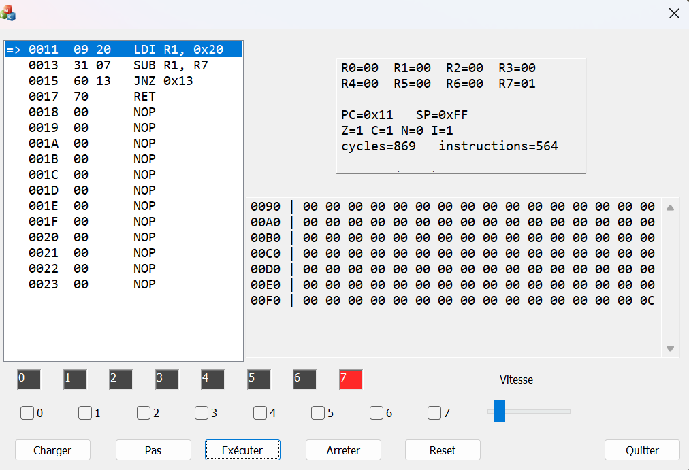
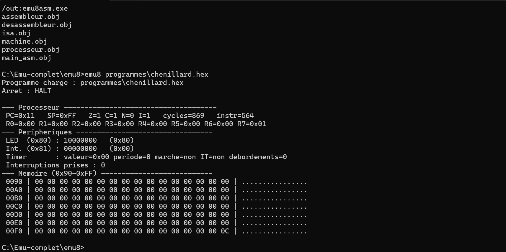
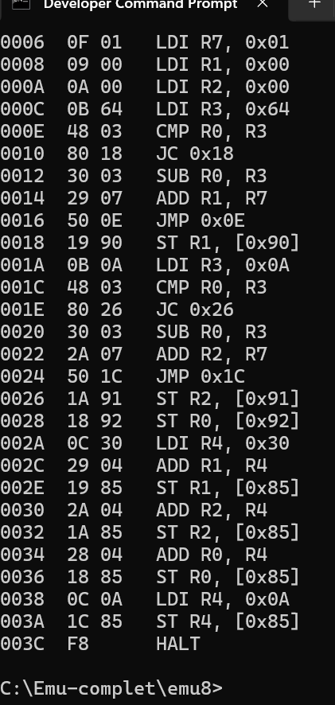
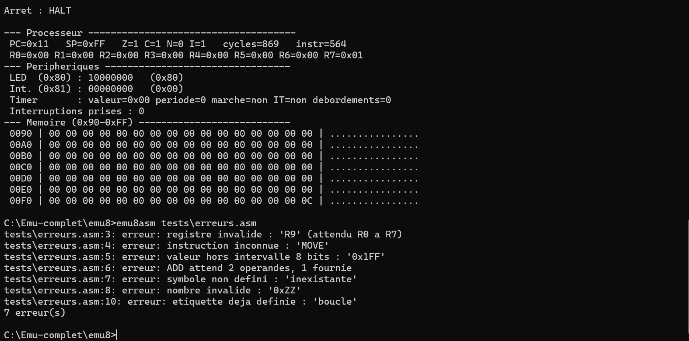
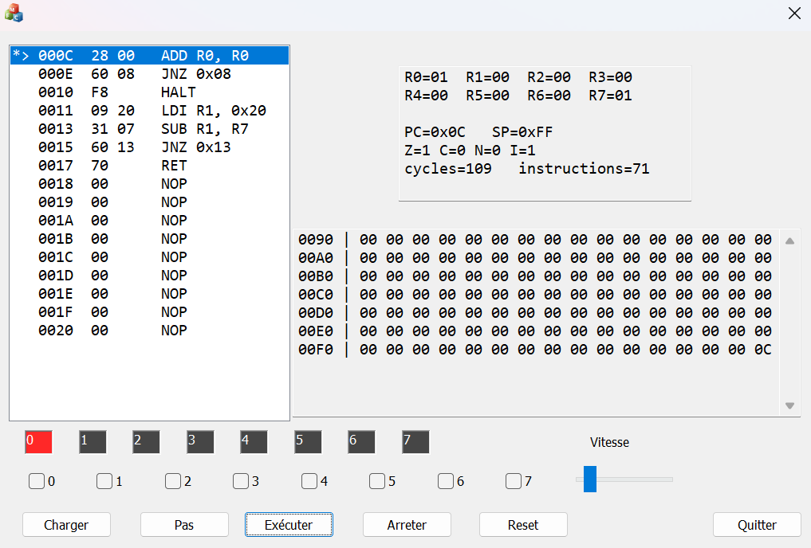
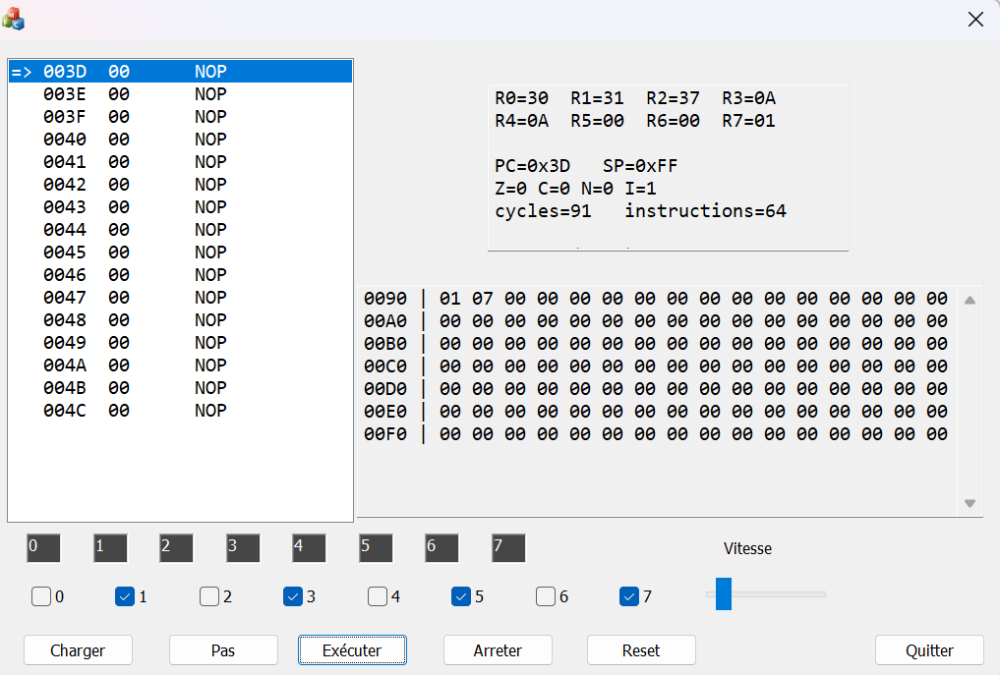

# emu8 — assembleur et émulateur d'un microcontrôleur 8 bits

Projet de programmation C++ — Master 1 EEA/TSI, Université de Bourgogne.

Ce projet reconstruit, en plus petit, la chaîne complète qu'on utilise sans y
penser quand on programme un microcontrôleur : un **assembleur** qui traduit du
texte en code machine, un **émulateur** qui exécute ce code instruction par
instruction, et une **interface graphique** qui donne à voir ce qui se passe à
l'intérieur.



<sub>L'interface MFC : code désassemblé, registres, dump mémoire, LED,
interrupteurs, points d'arrêt et vitesse réglable.</sub>

---

## Architecture

Le point central du projet : **le cœur ne dépend d'aucune bibliothèque
graphique.**

```
CBus            mémoire 256 octets + liste de périphériques
CPeripherique   classe abstraite
 ├─ CPortSortie    0x80       les 8 LED
 ├─ CPortEntree    0x81       les 8 interrupteurs
 ├─ CTimer         0x82-0x84  interruption sur débordement
 └─ CUart          0x85-0x86  console de sortie (option du sujet)
CProcesseur     registres, pas() = fetch / decode / execute
CDesassembleur  code machine → texte
CAssembleur     texte → code machine
CMachine        bus + CPU + périphériques, chargement, points d'arrêt

───────── tout ce qui précède : AUCUNE dépendance graphique ─────────

tools/main_console.cpp    mode console
emu8gui/                  interface MFC
```

Le processeur ne connaît que `CBus`. À chaque accès mémoire, le bus regarde si
un périphérique revendique l'adresse demandée et lui transmet l'opération ;
sinon il lit ou écrit dans la mémoire. Le processeur ignore jusqu'à l'existence
des LED.

L'interface, elle, ne fait qu'**observer** : elle appelle `pas()`, relit l'état
et le recopie dans ses contrôles. Les méthodes `listingAutourDuPc()` et
`dumpMemoire()` renvoient déjà des chaînes prêtes à afficher.

**La preuve :** le dossier `emu8/core/` se compile en bibliothèque statique sans
lier la moindre bibliothèque graphique, et les deux exécutables produisent des
résultats identiques au cycle près — 869 cycles et 564 instructions pour le
chenillard, en console comme sous MFC.

---

## Compiler

### L'interface graphique (Visual Studio 2022)

Nécessite le composant **MFC C++ pour les outils de génération v143**
(Visual Studio Installer → Modifier → Composants individuels).

1. Ouvrir `emu8gui/emu8gui.sln`
2. Générer (Ctrl + Maj + B)
3. Lancer (Ctrl + F5)

Un événement post-build copie automatiquement le dossier `emu8/programmes` à
côté de l'exécutable. L'application charge le chenillard au démarrage ; aucun
chemin n'est codé en dur.

### Les outils console (CMake)

```bash
cd emu8
cmake -B build
cmake --build build
```

Ou directement avec g++ :

```bash
g++ -std=c++17 -Icore core/*.cpp tools/main_console.cpp -o emu8
g++ -std=c++17 -Icore core/*.cpp tools/main_asm.cpp     -o emu8asm
```

---

## Guide d'utilisation

### L'interface

| Commande | Effet |
|---|---|
| **Charger** | ouvre un programme `.hex` ou `.bin` |
| **Pas** | exécute une seule instruction |
| **Exécuter** | exécution continue, vitesse réglée par le curseur |
| **Arrêter** | interrompt l'exécution continue |
| **Reset** | remet le processeur à zéro |
| **Double-clic** dans la liste du code | pose ou retire un point d'arrêt |
| **Cases à cocher** | pilotent les 8 interrupteurs du port d'entrée |

Le listing signale la ligne courante par `=>` et les points d'arrêt par une
étoile. Les LED s'allument en rouge selon le contenu du port de sortie.

### L'assembleur en ligne de commande

```
emu8asm fichier.asm [-o sortie.bin] [-s]

  -o <fichier>   écrit l'image mémoire (256 octets)
  -s             affiche la table des symboles
```

### L'émulateur en ligne de commande

```
emu8 programme[.hex|.bin] [options]

  -i          mode interactif (pas à pas)
  -t          affiche la trace d'exécution
  -e <val>    valeur initiale des 8 interrupteurs
  -c <n>      limite de cycles (défaut 100000, 0 = illimité)
  -b <adr>    point d'arrêt (répétable)
```

En mode interactif : `s [n]` pour n pas, `r` pour exécuter, `b <adr>` pour un
point d'arrêt, `m` pour le dump mémoire, `e <val>` pour les interrupteurs,
`z` pour un reset, `q` pour quitter.

---

## Jeu d'instructions

Le contrat complet est dans [`emu8/SPEC_ENCODAGE.md`](emu8/SPEC_ENCODAGE.md).
Le fichier `emu8/core/isa.h` en est la version faisant foi : **l'assembleur et
le processeur lisent la même table**, l'encodage ne peut donc pas diverger.

L'idée centrale tient en une ligne :

```
Octet 1 :  O O O O O r r r      5 bits d'opcode, 3 bits de registre
Octet 2 :  donnée immédiate, adresse, ou numéro de registre source
```

19 instructions tiennent sur 5 bits, 8 registres sur 3 bits, et le total fait
exactement un octet. Toutes les instructions font donc 1 ou 2 octets.

### Carte mémoire

| Adresses | Contenu |
|---|---|
| `0x00` | vecteur de reset |
| `0x02` | vecteur d'interruption |
| `0x00 – 0x7F` | zone de programme |
| `0x80` | port de sortie : 8 LED |
| `0x81` | port d'entrée : 8 interrupteurs |
| `0x82 – 0x84` | timer : valeur, contrôle, période |
| `0x85 – 0x86` | UART : donnée, état |
| `0x90 – 0xEF` | RAM de données |
| `0xF0 – 0xFF` | pile |

---

## Programmes de démonstration

Tous sont dans `emu8/programmes/`, avec leur source assembleur en commentaire
dans le `.hex` pour pouvoir être relus et modifiés à la main.

| Programme | Ce qu'il montre | Résultat attendu |
|---|---|---|
| `chenillard.hex` | boucles, `CALL`/`RET`, port de sortie | LED allumées une par une, HALT après 869 cycles |
| `entrees_sorties.hex` | lecture du port d'entrée, `CMP`, `JZ` | les LED recopient les interrupteurs ; HALT si les 8 sont à 1 |
| `timer_it.hex` | timer, interruptions, sauvegarde de l'état | 5 interruptions, LED = `00000101` |
| `binaire_decimal.hex` | division par soustractions, `JC`, UART | avec 170 : `0x90` contient `01 07 00`, UART = `"170"` |
| `uart.hex` | UART simulée | UART = `"OK"` |
| `anti_rebond.asm` | filtrage d'une entrée instable | un seul appui compté par changement d'état |

Le dossier `emu8/tests/` contient quatre programmes volontairement fautifs, pour
vérifier que les erreurs sont détectées au lieu de produire un comportement
indéfini : opcode invalide, débordement de pile, pile vide, et un fichier
assembleur contenant sept erreurs de syntaxe.

---

## Captures

**Mode console — le critère de validation du sujet**

Le processeur s'exécute sans interface graphique. Le chenillard termine en
869 cycles et 564 instructions ; l'interface MFC donne exactement les mêmes
chiffres.



**Assemblage avec listing et table des symboles**

Chaque ligne source est affichée en face des octets produits, suivie de la
relecture désassemblée qui vérifie l'aller-retour texte → machine → texte.



**Détection des erreurs**

L'assembleur ne s'arrête pas à la première faute : il les collecte toutes,
avec leur numéro de ligne, et les trie avant de les présenter.



**Point d'arrêt**

Un double-clic pose un point d'arrêt, signalé par une étoile. Le `*>` indique
que l'exécution s'est arrêtée exactement dessus, après 109 cycles.



**Conversion binaire vers décimal**

Les interrupteurs 1, 3, 5 et 7 valent 170. La mémoire contient `01 07 00` —
une centaine, sept dizaines, zéro unité — et les registres contiennent
`30 31 37`, soit les codes ASCII de « 0 », « 1 » et « 7 », prêts pour l'UART.



---

## État d'avancement

- [x] Assembleur deux passes : étiquettes, directives, erreurs numérotées
- [x] Désassembleur
- [x] Processeur : 19 instructions, pile, drapeaux, comptage des cycles
- [x] Périphériques mappés en mémoire : LED, interrupteurs, timer
- [x] Interruptions du timer avec sauvegarde et restauration de l'état
- [x] Mode console — critère de validation de l'architecture
- [x] Interface graphique MFC : pas à pas, points d'arrêt, vitesse réglable
- [x] UART simulée *(option du sujet)*
- [x] Programmes de démonstration *(option du sujet)*
- [ ] Mode trace avec retour arrière cycle par cycle *(option)*
- [ ] Chronogramme des huit sorties *(option)*

---

## Limites connues

Assumées, et documentées en section 8 de la spécification :

- pas d'adressage indirect, donc pas de parcours de tableau indexé ;
- pas d'instruction de décalage — on décale à gauche avec `ADD Rd, Rd` ;
- ni multiplication ni division — la conversion binaire-décimal procède par
  soustractions successives ;
- pas d'instruction pour masquer les interruptions depuis le programme ; c'est
  le bit 1 du registre de contrôle du timer qui joue ce rôle.

Les opcodes `0x90` à `0xF0` restent libres pour d'éventuels ajouts.
